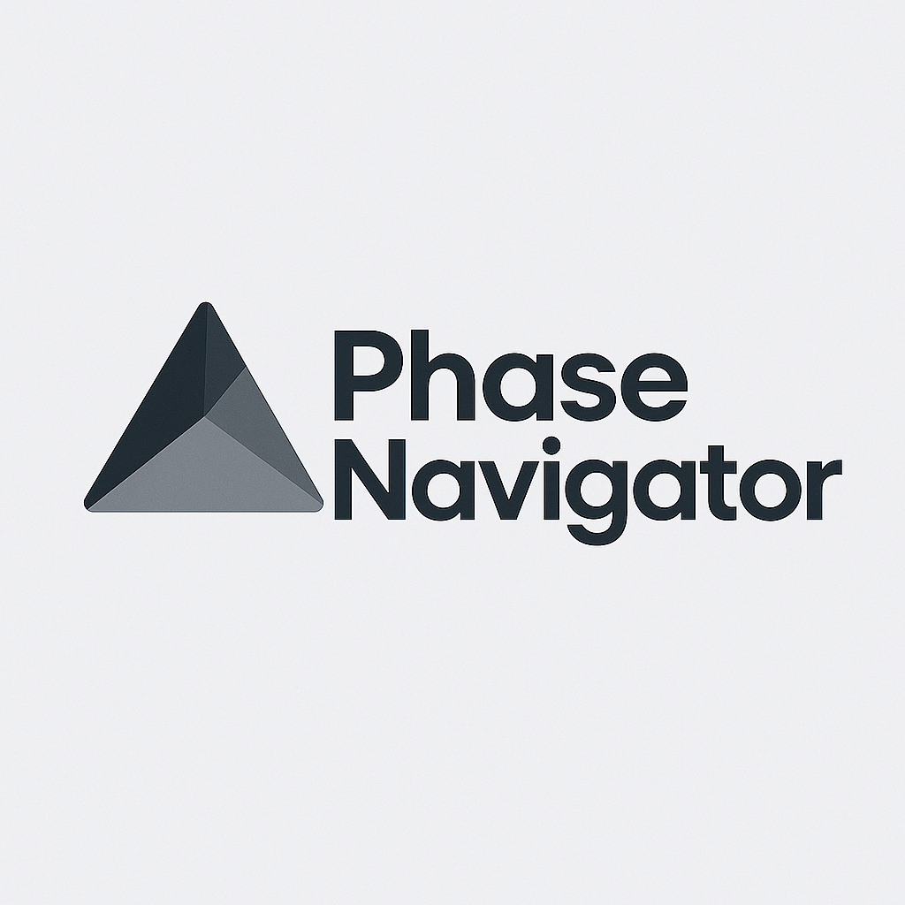
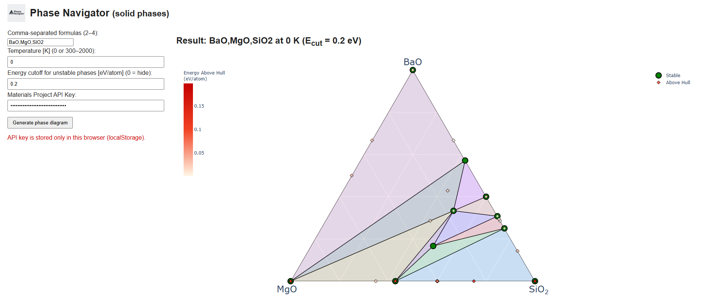

<p align="center">
  
</p>

# Phase Navigator

*Interactive phase diagram generator for up to 4 components (solid phases) using the Materials Project API and **pymatgen**.*

[](https://python.org)
[](https://fastapi.tiangolo.com)
[](https://materialsproject.org)

## ✨ Key Features

- ⚡ **Fast Performance**: Direct query to Materials Project with on-the-fly Plotly rendering
- 🔐 **Secure API Storage**: Cryptographically secure API key storage in browser using AES-GCM (256-bit) and IndexedDB
- 🌡️ **Temperature Control**: Support for 0 K or finite temperature (300–2000 K) calculations
- ⚙️ **Energy Cutoff**: Customizable energy cutoff for unstable phases visualization
- 📱 **Responsive Design**: Mobile-friendly interface with optimized layouts
- 📊 **Interactive Plots**: Fully interactive phase diagrams with zoom, pan, and hover
- 🔄 **Progress Tracking**: Real-time progress indicators during diagram generation
- 💾 **Smart Defaults**: Automatic form filling and parameter memory
- 🚫 **No Page Navigation**: Seamless single-page application with AJAX-based diagram generation
- 🛡️ **Robust Error Handling**: Comprehensive validation and user-friendly error messages

## 🚀 Quick Start

### Local Installation (virtual environment)

The project is developed and tested exclusively inside a Python virtual environment
located at `./venv`. Do **not** install the dependencies into your system Python:
a system-wide install almost always carries different (older) versions of
`fastapi` / `pymatgen` and leads to import errors such as
`ModuleNotFoundError: No module named 'mp_api'`.

#### Prerequisites

**Python 3.11 or newer is required** (`pymatgen`, `mp-api`, and `emmet-core` no
longer support Python 3.10).

```bash
# Ubuntu/Debian
sudo apt update
sudo apt install -y python3 python3-venv python3-pip build-essential gfortran git libblas-dev liblapack-dev

# macOS (using Homebrew)
brew install python@3.13 gcc gfortran openblas lapack
```

```powershell
# Windows: install Python 3.11+ from https://www.python.org/downloads/ or:
winget install Python.Python.3.13
```

#### Installation Steps

```bash
# Clone the repository
git clone https://github.com/ToshihiroIguchi/PhaseNavigator.git
cd PhaseNavigator
```

**Linux / macOS**

```bash
# Create ./venv and install all dependencies into it
./setup.sh

# Run the application (uses ./venv automatically)
./run.sh

# Run the test suite (uses ./venv automatically)
./test.sh
```

**Windows (PowerShell)**

```powershell
# Create .\venv and install all dependencies into it
.\setup.ps1

# Run the application (uses .\venv automatically)
.\run.ps1

# Run the test suite (uses .\venv automatically)
.\test.ps1
```

The application is then available at <http://localhost:8000>.
Set `HOST` or `PORT` before calling the run script to change the bind address.

#### Working in the environment manually

If you prefer to run commands yourself, activate the environment first so that
`python`, `pip`, `pytest`, and `uvicorn` all resolve to the virtual environment:

```bash
# Linux / macOS
source venv/bin/activate
python -m uvicorn app.main:app --host 0.0.0.0 --port 8000
deactivate
```

```powershell
# Windows (PowerShell)
.\venv\Scripts\Activate.ps1
python -m uvicorn app.main:app --host 0.0.0.0 --port 8000
deactivate
```

Without activation, always call the interpreter inside the environment explicitly
(`venv/bin/python -m ...` or `venv\Scripts\python.exe -m ...`).

#### Optional pymatgen add-ons

`enumlib` and `bader` are **not** required for phase diagram generation. They need
a Fortran toolchain and frequently fail to build on Windows, so they are opt-in:

```bash
./setup.sh --with-pmg-addons      # Linux / macOS
```

```powershell
.\setup.ps1 -WithPmgAddons        # Windows
```

## 📋 Usage

1. **Get Materials Project API Key**: Sign up and get your free API key at [next-gen.materialsproject.org/api](https://next-gen.materialsproject.org/api)
2. **Enter Chemical Formulas**: Input 2-4 chemical formulas separated by commas (e.g., `BaO, MgO, SiO2`). Full-width commas (`，`), ideographic commas (`、`) and semicolons (`;`, `；`) are also accepted. Spaces are **not** separators and are rejected inside a formula, because `Fe2O3 Al2O3` would otherwise be read as one compound.
3. **Save API Key**: Enter your API key once - it will be encrypted using AES-GCM and stored securely in your browser with non-extractable keys in IndexedDB
4. **Set Parameters**: 
   - Choose temperature (0 K for ground state, or 300-2000 K for finite temperature)
   - Adjust energy cutoff for unstable phases (default: 0.2 eV/atom)
   - Optionally enable **Include non-commercial data**. By default, entries under non-commercial terms (CC BY-NC 4.0, such as GNoME-derived materials that appear with R2SCAN) are excluded so results use CC BY 4.0 data only; the result summary shows how many entries were excluded. Enabling the option can change the convex hull, and the output may then be used for non-commercial purposes only.
5. **Generate Diagram**: Click "Generate Phase Diagram" and wait for the elapsed-time indicator to finish (quaternary systems can take up to about a minute)
6. **Explore Results**: Interactive phase diagram with temperature and energy cutoff displayed

### Example Input Combinations

- **Battery Materials**: `Li2O, CoO2, MnO2`
- **Ceramics**: `BaO, TiO2, SiO2` 
- **Superconductors**: `Y2O3, BaCO3, CuO`
- **Photovoltaics**: `CdTe, CdS, ZnS`

## 🛠️ Technical Details

### Architecture
- **Backend**: FastAPI with async support
- **Frontend**: Vanilla JavaScript with Plotly.js (the bundle shipped with the installed `plotly` Python package is served locally from `/vendor/plotly.min.js`, so the browser and server always use matching versions)
- **Data Source**: Materials Project API
- **Computation**: pymatgen for phase diagram calculations

### Computational Methodology

#### Materials Project DFT Calculations
Phase Navigator utilizes thermodynamic data from the Materials Project, which employs density functional theory (DFT) calculations using VASP (Vienna Ab Initio Simulation Package) v5.4.4:

**Key DFT Parameters:**
- **Exchange-Correlation Functional**: PBE GGA (Perdew-Burke-Ernzerhof Generalized Gradient Approximation)
- **Pseudopotentials**: PAW PBE pseudopotentials
- **Energy Cutoff**: 520 eV (1.3× highest recommended cutoff)
- **K-point Sampling**: 1000/(atoms per cell) using Pymatgen
- **Convergence Criteria**: Forces < 0.03 eV/Å
- **Smearing**: Gaussian smearing with 0.01 eV width
- **Magnetic Initialization**: High-spin (5 µB for d-block, 7 µB for f-block elements)
- **Conditions**: 0 K and 0 atm for ground state calculations

**Accuracy Considerations:**
- Band gaps typically underestimated by ~40% (common GGA limitation)
- GGA+U corrections applied for transition metal systems
- Formation energy accuracy: R² = 0.987, RMSE = 0.175 eV/atom vs. experimental data

#### Gibbs Free Energy Calculations
When finite temperature (300-2000 K) is selected, the application uses Materials Project's Gibbs free energy corrections:

**Thermodynamic Framework:**
- **Gibbs Free Energy**: G(T,P,N) = H(T,P,N) - TS(T,P,N) = E(T,P,N) + PV(T,P,N) - TS(T,P,N)
- **Formation Energy**: ΔGf(compound) = G(compound) - Σ μᵢNᵢ (where μᵢ is chemical potential)
- **Energy Corrections**: Applied to 14 anion species including oxides, peroxides, and superoxides
- **Mixing Schemes**: GGA/GGA+U energy corrections for improved accuracy across chemical systems

**Temperature-Dependent Corrections:**
- Vibrational contributions to entropy and enthalpy
- Thermal expansion effects on volume
- Electronic excitation contributions at high temperatures
- Correction terms calibrated against experimental phase boundary data

#### Phase Diagram Construction
The phase diagram generation follows these computational steps:

1. **Chemical System Query**: Retrieve all stable and metastable phases from Materials Project database
2. **Energy Filtering**: Apply user-defined energy cutoff to include/exclude unstable phases
3. **Convex Hull Construction**: Calculate thermodynamic stability using pymatgen's PhaseDiagram class
4. **Temperature Correction**: Apply Gibbs free energy corrections if T > 0 K
5. **Visualization**: Generate interactive Plotly.js phase diagrams with stability regions

**Limitations:**
- DFT calculations at 0 K/0 atm; finite temperature effects approximated
- Accuracy depends on chemical system similarity
- Configurational entropy of solid solutions not explicitly included
- Dynamic effects and kinetic barriers not considered

### API Endpoints
- `GET /` - Main application interface
- `POST /diagram` - Form submission handler (for browser compatibility)
- `POST /api/diagrams/` - JSON API for generating phase diagram data (requires `X-API-KEY` header)
- `GET /api/health/` - Application health check

### Security Features
- Client-side API key encryption using **AES-GCM (256-bit)** via native browser Web Crypto API
- Cryptographic key stored securely in **IndexedDB** as non-extractable (`extractable: false`)
- Automatic API key persistence with format validation
- Rate limiting (10 requests per 30 seconds)
- Input validation and sanitization
- Strictly no server-side API key storage or environment variable fallbacks
- Secure storage management with corruption detection

## 📸 Screenshots



*Interactive phase diagram generation with real-time progress tracking and parameter display*

## 🔧 Configuration

### Environment Variables
- `PORT`: Application port (default: 8000)
- `HOST`: Application host (default: 0.0.0.0)

The Materials Project API key is **never** read from the environment or stored on the
server. It is supplied by the browser through the `X-API-KEY` header on every request.

## 📝 Requirements

- **Python 3.11+** with `venv` (3.10 and older are not supported by the current
  `pymatgen` / `mp-api` / `emmet-core` releases)
- **Materials Project API Key** (free registration required)
- **Modern web browser** with JavaScript enabled
- **System dependencies** (for local installation): build-essential, gfortran, git, libblas-dev, liblapack-dev

## 🤝 Contributing

Development conventions (language policy, virtual environment rules, coding and commit
standards) are documented in [CLAUDE.md](CLAUDE.md). Please run `./test.sh` (or
`.\test.ps1`) inside the virtual environment before opening a pull request.

1. Fork the repository
2. Create a feature branch (`git checkout -b feature/amazing-feature`)
3. Commit your changes (`git commit -m 'Add amazing feature'`)
4. Push to the branch (`git push origin feature/amazing-feature`)
5. Open a Pull Request

## ⚖️ Legal & Disclaimers

### License
This project is licensed under the MIT License - see the [LICENSE](LICENSE) file for details.

### Disclaimer
This software is provided "as is" without warranty of any kind. The authors are not responsible for:
- Data accuracy or completeness from the Materials Project API
- Any damages or losses resulting from the use of this software
- The availability or reliability of external APIs and services
- Any research conclusions or decisions made based on generated phase diagrams

### Data Source Attribution
This application uses data from the **Materials Project**, which should be properly cited in any research or publication:
> Jain, A., Ong, S. P., Hautier, G., Chen, W., Richards, W. D., Dacek, S., ... & Persson, K. A. (2013). Commentary: The Materials Project: A materials genome approach to accelerating materials innovation. APL materials, 1(1), 011002.

### Usage Responsibility
Users are responsible for:
- Obtaining and maintaining valid Materials Project API keys
- Complying with Materials Project's terms of service
- Proper attribution of data sources in research and publications
- Validating computational results through appropriate scientific methods
- Ensuring compliance with their institution's data usage policies

## 🙏 Acknowledgments

- [Materials Project](https://materialsproject.org) for providing the comprehensive materials database
- [pymatgen](https://pymatgen.org) for materials analysis tools
- [Plotly.js](https://plotly.com/javascript/) for interactive plotting capabilities
- [FastAPI](https://fastapi.tiangolo.com) for the modern web framework

## 🐛 Troubleshooting

### Common Installation Issues

**`ModuleNotFoundError: No module named 'mp_api'` (or `httpx` / `pymatgen` import errors):**

The command ran against the system Python instead of the project virtual environment.
Use the wrapper scripts (`./run.sh`, `./test.sh`, `.\run.ps1`, `.\test.ps1`), activate the
environment, or call the interpreter inside it explicitly:

```bash
# Linux / macOS
venv/bin/python -m pytest
```

```powershell
# Windows
venv\Scripts\python.exe -m pytest
```

**Dependency resolution installs very old package versions:**

Your interpreter is older than Python 3.11. Check with `python --version` and recreate the
environment with a supported interpreter:

```bash
rm -rf venv && PYTHON_BIN=python3.13 ./setup.sh
```

```powershell
Remove-Item -Recurse -Force venv; .\setup.ps1 -PythonBin python3.13
```

**`pmg config --install enumlib` fails:**

These add-ons are optional and unnecessary for phase diagram generation. Skip them, or
install them explicitly with `./setup.sh --with-pmg-addons` on a machine with a Fortran
toolchain.

**pip not found:**
```bash
# Ubuntu/Debian
sudo apt install python3-pip

# macOS
python3 -m ensurepip --upgrade
```

**Build dependencies missing:**
```bash
# Ubuntu/Debian
sudo apt install build-essential gfortran git libblas-dev liblapack-dev

# CentOS/RHEL
sudo yum groupinstall "Development Tools"
sudo yum install gcc-gfortran git blas-devel lapack-devel
```

## 📞 Support

If you encounter any issues or have questions:
1. Check the [Issues](../../issues) page for known problems
2. Create a new issue with detailed information about your problem
3. Include your browser, operating system, and any error messages

---

<p align="center">
  <strong>Phase Navigator</strong> - Making phase diagram generation accessible and interactive
</p>